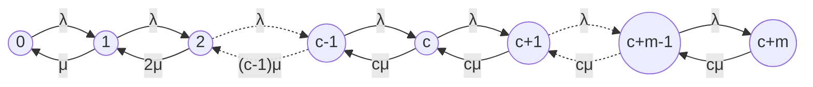

# Mathematical & Theoretical Specification: Analytical $M/M/c/m$ Queueing Model

**Project Topic**: Pizzeria Queuing System Optimization & Active Ovens Management (Option 4)  
**Author**: Role 3 (Theoretical Modeler & Technical Writer)  
**Target System**: Multi-Server Finite-Capacity Queueing System ($M/M/c/m$)  
**Operating Hours**: 09:00 – 22:00 (780 minutes / 13 hours total, time step $\Delta t = 5\text{ min}$)  
**Constraints**: Active ovens $c \le 10$, Queue buffer $m = 10$, Maximum system capacity $K = c + m \le 20$.

---

## 1. System Classification and Kendall Notation

Under standard Kendall notation, the pizzeria baking line is modeled as:
$$\mathbf{M / M / c / m}$$
or equivalently $\mathbf{M / M / c / K}$ where $K = c + m$:
- **Arrival Process ($M$)**: Orders arrive according to a homogeneous Poisson process with parameter $\lambda(t)$ (orders/hour or orders/minute). Inter-arrival times are independent and exponentially distributed with mean $1/\lambda$.
- **Service Process ($M$)**: Oven baking duration is exponentially distributed with mean service time $T_s = 1/\mu$. Service rate per active oven is $\mu$ (pizzas/hour or pizzas/minute).
- **Parallel Servers ($c$)**: Number of concurrently operating ovens, $1 \le c \le 10$. Each oven operates independently with capacity $1$ pizza at a time.
- **System Capacity ($m$ / $K$)**: Finite waiting line buffer $m = 10$. If an arriving order finds all $c$ ovens busy and $m$ orders already waiting in the queue (total system occupancy $K = c + m$), the incoming order is **rejected/lost** ($P_{reject}$).
- **Queue Discipline**: First-Come, First-Served (FCFS / FIFO).

---

## 2. State Transition Diagram (Continuous-Time Markov Chain)

Let the random variable $N(t) \in \{0, 1, 2, \dots, c+m\}$ denote the total number of orders in the pizzeria at time $t$ (both being baked in active ovens and waiting in the queue).

The system forms a **Birth-Death Process** with state space $S = \{0, 1, 2, \dots, c + m\}$.

### State Transition Rates
- **Birth rate (Arrivals)**:
  $$\lambda_k = \begin{cases} \lambda, & 0 \le k < c + m \\ 0, & k \ge c + m \end{cases}$$
- **Death rate (Completions)**:
  $$\mu_k = \begin{cases} k \mu, & 1 \le k \le c \\ c \mu, & c < k \le c + m \end{cases}$$

### Mermaid Transition Diagram

---

## 3. Kolmogorov Differential Equations and Steady-State Solution

### 3.1. Kolmogorov System
For time-dependent probabilities $P_k(t) = \mathbb{P}\{N(t) = k\}$:

$$\frac{d P_0(t)}{dt} = -\lambda P_0(t) + \mu P_1(t)$$
$$\frac{d P_k(t)}{dt} = \lambda P_{k-1}(t) - (\lambda + k\mu) P_k(t) + (k+1)\mu P_{k+1}(t), \quad 1 \le k < c$$
$$\frac{d P_c(t)}{dt} = \lambda P_{c-1}(t) - (\lambda + c\mu) P_c(t) + c\mu P_{c+1}(t)$$
$$\frac{d P_k(t)}{dt} = \lambda P_{k-1}(t) - (\lambda + c\mu) P_k(t) + c\mu P_{k+1}(t), \quad c < k < c + m$$
$$\frac{d P_{c+m}(t)}{dt} = \lambda P_{c+m-1}(t) - c\mu P_{c+m}(t)$$

### 3.2. Steady-State Algebraic Equations
Setting $\frac{d P_k(t)}{dt} = 0$ yields the local balance equations:
$$\lambda P_{k-1} = \mu_k P_k, \quad \forall k \in \{1, 2, \dots, c+m\}$$

Define the **offered load** $\rho$ and **channel traffic intensity** $\psi$:
$$\rho = \frac{\lambda}{\mu}, \qquad \psi = \frac{\rho}{c} = \frac{\lambda}{c\mu}$$

Expressing $P_k$ in terms of $P_0$:
- **Region 1: Free servers available ($1 \le k \le c$)**:
  $$P_k = \frac{\rho^k}{k!} P_0$$
- **Region 2: All ovens busy, queue forming ($c < k \le c + m$, let $j = k - c$)**:
  $$P_{c+j} = \frac{\rho^c}{c!} \left(\frac{\rho}{c}\right)^j P_0 = \frac{\rho^c}{c!} \psi^j P_0$$

### 3.3. Normalization Condition & Idle Probability ($P_0$)
Since $\sum_{k=0}^{c+m} P_k = 1$:
$$P_0^{-1} = \sum_{k=0}^c \frac{\rho^k}{k!} + \frac{\rho^c}{c!} \sum_{j=1}^m \psi^j$$

Evaluating the finite geometric series $\sum_{j=1}^m \psi^j$:
$$\sum_{j=1}^m \psi^j = \begin{cases} \psi \cdot \dfrac{1 - \psi^m}{1 - \psi}, & \psi \ne 1 \\[8pt] m, & \psi = 1 \end{cases}$$

Hence, the closed-form system idle probability is:
$$\boxed{P_0 = \left[ \sum_{k=0}^c \frac{\rho^k}{k!} + \frac{\rho^c}{c!} \cdot \frac{\psi(1 - \psi^m)}{1 - \psi} \right]^{-1} \quad (\psi \ne 1)}$$
$$\boxed{P_0 = \left[ \sum_{k=0}^c \frac{\rho^k}{k!} + \frac{\rho^c}{c!} \cdot m \right]^{-1} \quad (\psi = 1)}$$

---

## 4. Analytical Performance Metrics (QoS Formulas)

### 4.1. Rejection / Loss Probability ($P_{reject}$)
An order is rejected when all $c$ ovens and all $m$ queue spots are occupied (state $k = c + m$):
$$\boxed{P_{reject} = P_{c+m} = \frac{\rho^c}{c!} \psi^m P_0}$$

### 4.2. Relative and Absolute Throughput
- **Relative Throughput ($Q$)**: Probability that an arriving order is accepted:
  $$\boxed{Q = 1 - P_{reject} = 1 - P_{c+m}}$$
- **Absolute Throughput ($A$)**: Mean rate of successfully admitted and baked orders per unit time:
  $$\boxed{A = \lambda \cdot Q = \lambda (1 - P_{reject})}$$

### 4.3. Average Number of Busy Ovens ($L_s$) and Server Utilization ($\eta$)
By flow conservation (Little's Law applied to the servers):
$$\boxed{L_s = \frac{A}{\mu} = \rho(1 - P_{reject})}$$
$$\boxed{\eta = \frac{L_s}{c} = \psi(1 - P_{reject})}$$

### 4.4. Average Queue Length ($L_q$)
The expected number of waiting orders in buffer:
$$L_q = \sum_{j=1}^m j \cdot P_{c+j} = \frac{\rho^c}{c!} P_0 \sum_{j=1}^m j \psi^j$$

Using the closed-form derivative of the geometric progression:
$$\boxed{L_q = \frac{\rho^c}{c!} P_0 \cdot \frac{\psi \left[1 - (m+1)\psi^m + m\psi^{m+1}\right]}{(1 - \psi)^2} \quad (\psi \ne 1)}$$
$$\boxed{L_q = \frac{\rho^c}{c!} P_0 \cdot \frac{m(m+1)}{2} \quad (\psi = 1)}$$

### 4.5. Average Number of Orders in System ($L$)
$$\boxed{L = L_s + L_q = \sum_{k=0}^{c+m} k P_k}$$

### 4.6. Average Wait Time in Queue ($W_q$) and Turnaround Time ($W$)
By **Little's Law** applied to the waiting buffer with effective arrival rate $A$:
$$\boxed{W_q = \frac{L_q}{A} = \frac{L_q}{\lambda(1 - P_{reject})}}$$

Total average duration an admitted order spends in the pizzeria (waiting + baking):
$$\boxed{W = W_q + \frac{1}{\mu} = \frac{L}{A}}$$

---

## 5. Economic Optimization Model

For any time window of duration $T$ hours with $c$ active ovens:

### 5.1. Revenue Function
$$R(c) = A(c) \cdot T \cdot R_{order}$$
Where $R_{order}$ is the gross profit margin per completed pizza (default: $250\text{ UAH}$).

### 5.2. Operational Cost Function
Running an oven incurs electricity and thermal wear costs. In active mode, ovens fluctuate between busy baking and idle heating:
$$C_{ovens}(c) = T \cdot C_{oven\_hr} \cdot \left[ L_s(c) + (c - L_s(c)) \cdot \alpha_{idle} \right]$$
Where:
- $C_{oven\_hr}$ = hourly cost to run an oven (default: $60\text{ UAH/hr}$).
- $\alpha_{idle}$ = idle power ratio (default: $0.5$, matching `idle_power_ratio` in `structures.hpp`).

### 5.3. Opportunity / Penalty Cost of Lost Customers
$$C_{lost}(c) = \lambda \cdot P_{reject}(c) \cdot T \cdot C_{penalty}$$
Where $C_{penalty}$ is the lost customer penalty (default: $50\text{ UAH}$).

### 5.4. Fixed Hourly Overheads
$$C_{fixed} = T \cdot C_{overhead\_hr}$$

### 5.5. Objective Function: Optimal Active Ovens $c^*$
$$\max_{c \in \{1, 2, \dots, 10\}} \Pi(c) = R(c) - C_{ovens}(c) - C_{lost}(c) - C_{fixed}$$
Subject to:
$$P_{reject}(c) \le P_{max}^{target} \quad (\text{e.g., } 0.05)$$
$$W_q(c) \le W_{max}^{target} \quad (\text{e.g., } 15\text{ minutes})$$

---

## 6. Time-Window Dynamics (780 Minutes / 13 Hours: 09:00 – 22:00)

Because pizza demand fluctuates heavily throughout the day, the 780-minute operating window is partitioned into dynamic regimes:

| Window Name | Time Interval | Duration | $\lambda$ (orders/hr) | $\mu$ (per oven/hr) | Benchmark $c^*$ |
| :--- | :---: | :---: | :---: | :---: | :---: |
| **Morning Ramp-Up** | 09:00 – 11:30 | 2.5 hrs (150 min) | $8.0$ | $6.0$ | $2$ |
| **Lunch Rush** | 11:30 – 14:00 | 2.5 hrs (150 min) | $36.0$ | $6.0$ | $7$ |
| **Afternoon Lull** | 14:00 – 17:30 | 3.5 hrs (210 min) | $16.0$ | $6.0$ | $3$ |
| **Dinner Peak** | 17:30 – 20:30 | 3.0 hrs (180 min) | $48.0$ | $6.0$ | $9$ |
| **Evening Closing** | 20:30 – 22:00 | 1.5 hrs (90 min) | $12.0$ | $6.0$ | $2$ |

---

## 7. Code Architecture Integration

- **Python Library**: `analytical/` (`solver.py`, `economics.py`, `schedule.py`, `cli.py`)
- **C++ Engine Header**: `simulation_engine/analytical_solver.hpp` (direct drop-in for Participant 1 and Participant 2)
- **Unit Test Suite**: `tests/test_analytical.py` (verifies Little's Law, boundary conditions, and financial equations).
